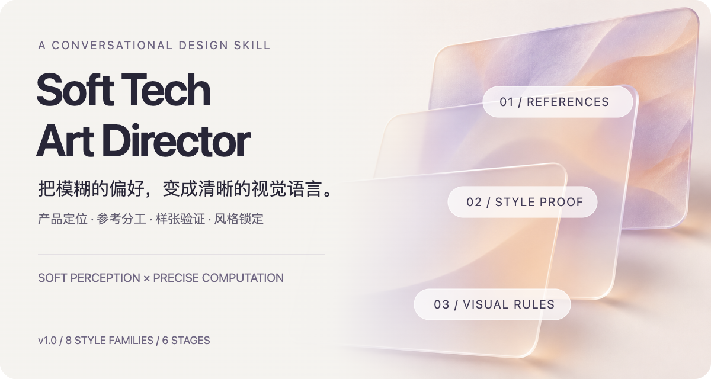
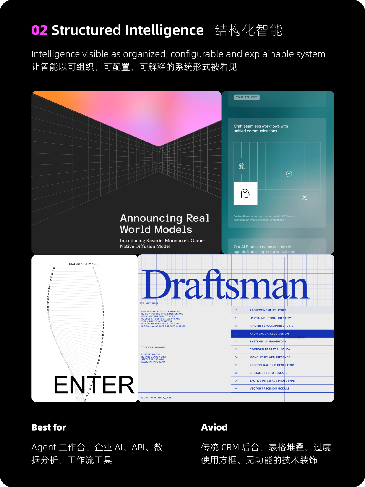

<p align="center">
  
</p>

# Soft Tech Art Director

**把「我想要好看一点」，变成有参考、有样张、能落地的视觉方向。**

一个面向 AI 产品的对话式美术指导 Skill。先理解产品中的智能如何工作，再一起选择风格、拆解参考、验证画面，最后整理成后续设计与开发可以使用的规则。

[快速开始](#快速开始) · [六阶段旅程](#六阶段设计旅程) · [八种风格](#八种风格不是八套模板) · [主说明](./SKILL.md)

## 先看风格，再谈效果

随包提供 **8 张风格总览卡**。下面展示其中两种方向：一边让智能安静地退居幕后，一边把智能呈现为可解释的系统。

<table>
<tr>
<td width="50%"><a href="./assets/style-cards/01-quiet-intelligence.png"></a></td>
<td width="50%"><a href="./assets/style-cards/02-structured-intelligence.png"></a></td>
</tr>
</table>

*风格卡中的画面是用于比较方向的参考拼图，不是本 Skill 生成的案例，也不是需要整套照搬的页面。顶部磨砂主视觉是为本仓库制作的概念插画。*

## 不从蓝紫渐变开始

Soft Tech 在这里意味着 **柔和的感知表达 × 精确的计算结构**，而不是固定的装饰配方。

- **产品先于审美。** 先说清楚 AI 在感知、整理、推荐还是执行，再决定视觉隐喻。
- **每张参考只负责一件事。** 分开借鉴布局、材质、配色或文字，写明不跟随的部分。
- **先验证，再锁定。** 设计参数先作为草案；风格样张得到明确确认后，才整理成最终规范。
- **每条规则有依据。** 最终规则要能对应产品要求、已确认的参考图或批准的样张。

它适合还说不清偏好的人，也适合已有页面、但总觉得像通用 AI 模板的团队。

## 六阶段设计旅程

每轮只做一个关键决定，逐步把个人偏好转成产品需要的视觉语言。

1. **产品定位** — 理解用户、产品任务和 AI 的作用，确认一句话产品表达。
2. **视觉坐标** — 在理性与感性、安静与张扬、结构与流动等五组坐标上找到位置。
3. **风格探索** — 比较三个有明显差别的方向，选择一个暂定路线。
4. **参考反馈** — 分别寻找核心画面、布局、颜色和文字参考，明确借鉴与排除内容。
5. **风格样张** — 先交付规则草案，再生成一张产品专属静态关键帧，验证方向。
6. **风格锁定** — 用户确认样张后，校准最终规则和设计参数，交给后续制作流程。

**方向选择 → 原图参考 → 规则草案 → 样张确认 → 最终规范 → 制作**

### 你会拿到什么？

- **参考看板与参考约定**：每张图片的职责、借鉴点与排除项。
- **Style Proof／风格样张**：在真实产品内容上验证方向的静态关键画面。
- **Style Profile／风格档案**：产品表达、风格家族、视觉隐喻和使用规则。
- **Design Tokens／设计参数**：颜色、字体、间距、圆角、边框、表面、光线和动效的具体约定。
- **视觉依据表**：把最终规则对应到产品要求、参考编号或样张。

参考看板供人讨论；生成样张时，原始参考图应分别输入，而不是默认使用拼好的看板。

## 快速开始

### 1 · 选择安装方式

#### 通用安装（推荐）

已安装 Node.js 与 npm 的用户，可以通过 [Skills CLI](https://github.com/vercel-labs/skills/blob/main/docs/commands.md) 安装，无需手动选择克隆目录：

```bash
npx skills add Stanley-baby/soft-tech-art-director
```

按照交互提示选择目标工具与安装范围。此方式支持 Skills CLI 已适配的工具；不同工具的生图、检索和文件操作能力仍取决于各自环境。

只安装到 Codex 的个人目录、供各项目使用：

```bash
npx skills add Stanley-baby/soft-tech-art-director --skill soft-tech-art-director --agent codex --global
```

不加 `--global` 时安装到当前项目。只想确认仓库里有哪些 Skill，可以先运行：

```bash
npx skills add Stanley-baby/soft-tech-art-director --list
```

这使用的是第三方 Skills CLI，不代表本仓库已经上架任何插件市场。

<details>
<summary>手动安装到 Codex（保留原方式）</summary>

需要 Git；如果同名目录已经存在，请先检查现有版本。

```bash
mkdir -p "$HOME/.agents/skills"
git clone https://github.com/Stanley-baby/soft-tech-art-director.git \
  "$HOME/.agents/skills/soft-tech-art-director"
```

目录位置与调用方式参见 [OpenAI 官方 Skill 文档](https://learn.chatgpt.com/docs/build-skills)。

</details>

### 2 · 用一个具体产品开始

在支持 `$skill-name` 的 Codex 界面中输入：

```text
使用 $soft-tech-art-director，帮我确定产品视觉方向。

产品：一个把零散旅行收藏整理成行程的 AI 助手。
用户：喜欢自主探索、但不想花太多时间做攻略的旅行者。
AI 的作用：理解兴趣、地点和可用时间，生成可以调整的计划。
目标页面：产品首页。
希望传达：安静、有文化感，但仍然容易操作。

先从产品定位开始，每轮只让我做一个关键决定。
不要在风格样张确认前锁定最终设计参数。
```

后续按提示比较方向、提供参考图，并对样张明确选择：**确认风格 / 调整关键帧 / 更换参考图**。

### 也可以只评审已有设计

上传截图后输入：

```text
使用 $soft-tech-art-director 评审这张页面。
解释它目前传达的感觉，按五个维度评分并给出可见依据。
只提出影响最大的三项修改，再给出可直接使用的修订说明。
```

五个维度是：概念一致性、独特性、信息层级、克制程度、制作就绪程度。

## 八种风格，不是八套模板

这些名称是本 Skill 的工作分类，不是通行的设计史标准术语。点击名称查看对应风格卡。

| 风格方向 | 适合表达 |
| --- | --- |
| [Quiet Intelligence · 静默智能](./assets/style-cards/01-quiet-intelligence.png) | 专注、知识管理、轻量助手，让内容占据前景 |
| [Structured Intelligence · 结构化智能](./assets/style-cards/02-structured-intelligence.png) | Agent 工作台、企业 AI、可配置与可解释的系统 |
| [Signal Field · 信号场](./assets/style-cards/03-signal-field.png) | 推荐、匹配、知识关系与协作路径 |
| [Warm Human AI · 温感人本智能](./assets/style-cards/04-warm-human-ai.png) | 陪伴、教练、偏好学习与人的参与 |
| [Generative Perception · 生成式感知](./assets/style-cards/05-generative-perception.png) | 多模态、音视频、生成与信息转换 |
| [Poetic Intelligence · 诗性智能](./assets/style-cards/06-poetic-intelligence.png) | 旅行、文化、地点、记忆与叙事 |
| [Quiet Gradient Intelligence · 静谧渐变智能](./assets/style-cards/07-quiet-gradient-intelligence.png) | 后台复杂计算与前景平静清晰的 AI 服务 |
| [Dark Signal Intelligence · 暗场信号智能](./assets/style-cards/08-dark-signal-intelligence.png) | 实时监测、风险、状态变化与异常信号 |

## 原始 ZIP 备份

[v1.0 原始文件备份](https://github.com/Stanley-baby/soft-tech-art-director/releases/tag/source-v1.0) 保存用户提供的源文件压缩包，**原样上传，没有重新打包**。包内 21 个技能文件与首次发布的原始技能内容一致。

- [下载原始 ZIP](https://github.com/Stanley-baby/soft-tech-art-director/releases/download/source-v1.0/Soft-Tech-Art-Director-v1.0.zip)
- [下载 SHA-256 校验文件](https://github.com/Stanley-baby/soft-tech-art-director/releases/download/source-v1.0/SHA256SUMS.txt)

原包的 SHA-256：

```text
847cbf94241142ae5ff148cfc409ada9cdab336050678f1dee42730a97f27b59
```

下载两个附件到同一目录后，可在 macOS 上核对文件是否完整：

```bash
shasum -a 256 -c SHA256SUMS.txt
```

原始 ZIP 用于归档，不含本仓库后来新增的 README 和展示素材。GitHub 自动提供的 **Source code (zip)** 是仓库快照，不是这份原始压缩包。日常安装请使用上面的仓库安装命令；备份放在 Release 附件中，不进入日常代码目录。

## 内容与工具

```text
SKILL.md                     主工作流程与交付规则
agents/openai.yaml           显示信息与调用配置
assets/style-cards/          8 张风格总览卡
references/                  10 份分类、参考、样张与评审指南
scripts/build_case_board.py  用 3–4 张本地图片生成 SVG 参考看板
assets/readme/               README 主视觉与可编辑源文件
```

参考看板脚本只使用 Python 3 标准库，无需额外依赖。从仓库根目录运行：

```bash
python3 scripts/build_case_board.py --spec case-board.json --output case-board.svg
```

JSON 输入示例见 [参考看板指南](./references/case-board-workflow.md)；样张生成要求见 [Style Proof 工作流程](./references/style-proof-workflow.md)。

## 使用前了解

- 本仓库提供工作方法、素材与提示规则，不自带图像模型或 Figma 编辑器。生图、检索和界面制作取决于宿主工具。
- 风格卡是方向总览；卡片中提到的独立原始参考图库没有随包附带。样张需要另外提供或收集原图。
- 静态样张验证视觉方向，不代替真实交互、响应式布局与可访问性验收。
- 原始包未附许可证，本仓库未额外授予原始内容的使用许可。风格卡中的第三方图片、截图与品牌内容不因公开展示而获得重新授权。

---

**从一个具体产品开始，而不是从一串风格形容词开始。**

打开 [SKILL.md](./SKILL.md)，或安装后告诉它：你的产品为谁做什么。
